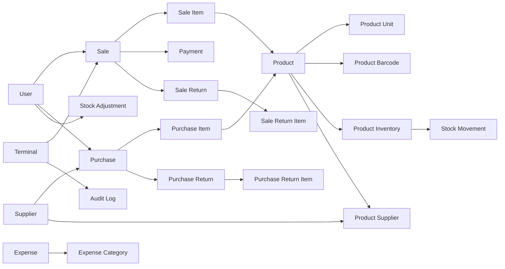

# ERD & Domain Model v1.0

**Project:** Retail POS & Inventory Management System  
**Status:** Draft for Technical Review  
**Basis:** PRD v1.0 + Critical Decisions v1.0  
**Architecture:** Decoupled Monorepo, Laravel API, React SPA, Redis, Reverb/Echo  
**Scope:** Logical domain model. Belum merupakan physical Laravel migration final.

---

# 1. Tujuan Dokumen

Dokumen ini mendefinisikan:

- domain utama sistem;
- entity inti;
- relasi antar-entity;
- data yang menjadi source of truth;
- aturan integritas utama;
- snapshot yang diperlukan untuk histori transaksi;
- batas antara transaksi, inventory ledger, dan reporting.

Prinsip desain:

1. Histori transaksi yang sudah finalized tidak diedit secara destruktif.
2. Inventory menggunakan **base unit** sebagai satuan penyimpanan.
3. `stock_movements` menjadi ledger perubahan stok.
4. Saldo stok terkini disimpan pada `product_inventory` sebagai current balance.
5. Harga/nama/satuan penting pada transaksi disimpan sebagai snapshot agar histori tidak berubah ketika master data berubah.
6. Offline sale menggunakan UUID dari client untuk idempotency.
7. Report dihitung dari transactional data, bukan disimpan sebagai tabel laporan terpisah.
8. Multi-company / multi-branch belum dimasukkan karena belum menjadi requirement MVP.

---

# 2. Bounded Context / Domain

Domain dibagi menjadi:

```text
Identity & Access
Company & Terminal
Product Catalog
Supplier & Purchasing
Inventory
Sales / POS
Payment
Returns & Corrections
Expense & Profit
Audit & Offline Sync
```

---

# 3. High-Level Domain Relationship



---

# 4. Logical ERD

```mermaid
erDiagram

    COMPANIES {
        bigint id PK
        string name
        text address
        string phone
        string logo_path
        datetime created_at
        datetime updated_at
    }

    USERS {
        bigint id PK
        string name
        string username
        string email
        string password
        boolean is_active
        datetime created_at
        datetime updated_at
    }

    ROLES {
        bigint id PK
        string name
        string code
    }

    PERMISSIONS {
        bigint id PK
        string name
        string code
    }

    USER_ROLES {
        bigint user_id FK
        bigint role_id FK
    }

    ROLE_PERMISSIONS {
        bigint role_id FK
        bigint permission_id FK
    }

    TERMINALS {
        bigint id PK
        uuid terminal_uuid UK
        string name
        string device_name
        boolean is_active
        datetime last_seen_at
    }

    CATEGORIES {
        bigint id PK
        string name
        boolean is_active
    }

    UNITS {
        bigint id PK
        string code
        string name
        boolean is_active
    }

    PRODUCTS {
        bigint id PK
        string sku UK
        string name
        bigint category_id FK
        string size
        string color
        string variant_label
        boolean is_active
        datetime created_at
        datetime updated_at
    }

    PRODUCT_UNITS {
        bigint id PK
        bigint product_id FK
        bigint unit_id FK
        decimal conversion_to_base
        decimal selling_price
        boolean is_base
        boolean is_active
    }

    PRODUCT_BARCODES {
        bigint id PK
        bigint product_id FK
        bigint product_unit_id FK
        string barcode UK
        boolean is_primary
    }

    SUPPLIERS {
        bigint id PK
        string code UK
        string name
        text address
        string city
        string phone
        boolean is_active
    }

    PRODUCT_SUPPLIERS {
        bigint id PK
        bigint product_id FK
        bigint supplier_id FK
        string supplier_product_code
        boolean is_active
    }

    PURCHASES {
        bigint id PK
        string purchase_no UK
        bigint supplier_id FK
        bigint recorded_by FK
        date purchased_at
        string supplier_invoice_no
        string status
        decimal subtotal
        decimal total
        datetime created_at
    }

    PURCHASE_ITEMS {
        bigint id PK
        bigint purchase_id FK
        bigint product_id FK
        bigint product_unit_id FK
        decimal quantity
        decimal base_quantity
        decimal unit_cost
        decimal base_unit_cost
        decimal subtotal
    }

    PURCHASE_ATTACHMENTS {
        bigint id PK
        bigint purchase_id FK
        string file_path
        string file_name
        string mime_type
    }

    PURCHASE_RETURNS {
        bigint id PK
        bigint purchase_id FK
        bigint supplier_id FK
        bigint created_by FK
        string return_no UK
        string status
        text reason
        datetime returned_at
    }

    PURCHASE_RETURN_ITEMS {
        bigint id PK
        bigint purchase_return_id FK
        bigint purchase_item_id FK
        bigint product_id FK
        decimal base_quantity
        decimal value
    }

    PRODUCT_INVENTORY {
        bigint id PK
        bigint product_id FK
        decimal quantity_base
        decimal average_cost
        datetime updated_at
    }

    STOCK_MOVEMENTS {
        bigint id PK
        bigint product_id FK
        bigint created_by FK
        bigint terminal_id FK
        string movement_type
        decimal quantity_delta_base
        decimal unit_cost
        string reference_type
        bigint reference_id
        text notes
        datetime occurred_at
    }

    STOCK_ADJUSTMENTS {
        bigint id PK
        string adjustment_no UK
        bigint created_by FK
        string reason_type
        text notes
        datetime adjusted_at
    }

    STOCK_ADJUSTMENT_ITEMS {
        bigint id PK
        bigint stock_adjustment_id FK
        bigint product_id FK
        decimal before_quantity_base
        decimal adjustment_quantity_base
        decimal after_quantity_base
    }

    STOCK_OPNAMES {
        bigint id PK
        string opname_no UK
        bigint created_by FK
        string status
        datetime started_at
        datetime completed_at
    }

    STOCK_OPNAME_ITEMS {
        bigint id PK
        bigint stock_opname_id FK
        bigint product_id FK
        decimal system_quantity_base
        decimal physical_quantity_base
        decimal difference_base
    }

    PRODUCT_INVENTORY_POLICIES {
        bigint id PK
        bigint product_id FK
        decimal manual_reorder_point
        integer lead_time_days
        integer safety_days
        boolean auto_reorder_point_enabled
    }

    INVENTORY_POLICY_SETTINGS {
        bigint id PK
        integer moving_window_days
        decimal fast_percentile
        decimal middle_percentile
        datetime updated_at
    }

    SALES {
        bigint id PK
        uuid client_uuid UK
        string sale_no UK
        bigint cashier_id FK
        bigint terminal_id FK
        string status
        boolean created_offline
        decimal subtotal
        decimal discount_total
        decimal grand_total
        datetime completed_at
        datetime created_at
    }

    SALE_ITEMS {
        bigint id PK
        bigint sale_id FK
        bigint product_id FK
        bigint product_unit_id FK
        string sku_snapshot
        string product_name_snapshot
        string unit_name_snapshot
        decimal quantity
        decimal conversion_to_base_snapshot
        decimal base_quantity
        decimal unit_price
        decimal discount_amount
        decimal net_total
        decimal cost_per_base_snapshot
        decimal cost_total
    }

    PAYMENT_METHODS {
        bigint id PK
        string code UK
        string name
        boolean is_active
    }

    PAYMENTS {
        bigint id PK
        bigint sale_id FK
        bigint payment_method_id FK
        decimal amount
        string reference_no
        datetime paid_at
    }

    SALE_RETURNS {
        bigint id PK
        string return_no UK
        bigint sale_id FK
        bigint created_by FK
        string status
        text reason
        decimal total_value
        datetime returned_at
    }

    SALE_RETURN_ITEMS {
        bigint id PK
        bigint sale_return_id FK
        bigint sale_item_id FK
        bigint product_id FK
        decimal base_quantity
        decimal refund_value
    }

    REFUNDS {
        bigint id PK
        bigint sale_return_id FK
        bigint payment_method_id FK
        decimal amount
        string reference_no
        datetime refunded_at
    }

    EXPENSE_CATEGORIES {
        bigint id PK
        string name
        boolean is_active
    }

    EXPENSES {
        bigint id PK
        bigint expense_category_id FK
        bigint recorded_by FK
        date expense_date
        decimal amount
        string description
        string reference_no
        datetime created_at
    }

    AUDIT_LOGS {
        bigint id PK
        bigint user_id FK
        bigint terminal_id FK
        string action
        string auditable_type
        bigint auditable_id
        json old_values
        json new_values
        text reason
        datetime created_at
    }

    SYNC_CONFLICTS {
        bigint id PK
        uuid client_uuid
        bigint terminal_id FK
        string entity_type
        string conflict_type
        json payload
        string status
        text resolution_notes
        datetime created_at
        datetime resolved_at
    }

    COMPANIES ||--o{ TERMINALS : has

    USERS ||--o{ USER_ROLES : assigned
    ROLES ||--o{ USER_ROLES : contains
    ROLES ||--o{ ROLE_PERMISSIONS : grants
    PERMISSIONS ||--o{ ROLE_PERMISSIONS : included

    CATEGORIES ||--o{ PRODUCTS : groups
    PRODUCTS ||--o{ PRODUCT_UNITS : sold_as
    UNITS ||--o{ PRODUCT_UNITS : defines
    PRODUCTS ||--o{ PRODUCT_BARCODES : identified_by
    PRODUCT_UNITS o|--o{ PRODUCT_BARCODES : identifies_unit

    PRODUCTS ||--o{ PRODUCT_SUPPLIERS : sourced_from
    SUPPLIERS ||--o{ PRODUCT_SUPPLIERS : supplies

    SUPPLIERS ||--o{ PURCHASES : receives
    USERS ||--o{ PURCHASES : records
    PURCHASES ||--|{ PURCHASE_ITEMS : contains
    PRODUCTS ||--o{ PURCHASE_ITEMS : purchased
    PRODUCT_UNITS ||--o{ PURCHASE_ITEMS : purchased_as
    PURCHASES ||--o{ PURCHASE_ATTACHMENTS : has

    PURCHASES ||--o{ PURCHASE_RETURNS : may_have
    PURCHASE_RETURNS ||--|{ PURCHASE_RETURN_ITEMS : contains
    PURCHASE_ITEMS ||--o{ PURCHASE_RETURN_ITEMS : references

    PRODUCTS ||--|| PRODUCT_INVENTORY : balance
    PRODUCTS ||--o{ STOCK_MOVEMENTS : ledger
    USERS ||--o{ STOCK_MOVEMENTS : creates
    TERMINALS o|--o{ STOCK_MOVEMENTS : originates

    STOCK_ADJUSTMENTS ||--|{ STOCK_ADJUSTMENT_ITEMS : contains
    PRODUCTS ||--o{ STOCK_ADJUSTMENT_ITEMS : adjusts
    USERS ||--o{ STOCK_ADJUSTMENTS : creates

    STOCK_OPNAMES ||--|{ STOCK_OPNAME_ITEMS : contains
    PRODUCTS ||--o{ STOCK_OPNAME_ITEMS : counted
    USERS ||--o{ STOCK_OPNAMES : creates

    PRODUCTS ||--o| PRODUCT_INVENTORY_POLICIES : policy

    USERS ||--o{ SALES : cashier
    TERMINALS ||--o{ SALES : created_on
    SALES ||--|{ SALE_ITEMS : contains
    PRODUCTS ||--o{ SALE_ITEMS : sold
    PRODUCT_UNITS ||--o{ SALE_ITEMS : sold_as

    SALES ||--|{ PAYMENTS : paid_by
    PAYMENT_METHODS ||--o{ PAYMENTS : method

    SALES ||--o{ SALE_RETURNS : may_have
    SALE_RETURNS ||--|{ SALE_RETURN_ITEMS : contains
    SALE_ITEMS ||--o{ SALE_RETURN_ITEMS : references

    SALE_RETURNS ||--o{ REFUNDS : refunds
    PAYMENT_METHODS ||--o{ REFUNDS : method

    EXPENSE_CATEGORIES ||--o{ EXPENSES : categorizes
    USERS ||--o{ EXPENSES : records

    USERS ||--o{ AUDIT_LOGS : performs
    TERMINALS o|--o{ AUDIT_LOGS : occurs_on

    TERMINALS ||--o{ SYNC_CONFLICTS : produces
```



---

# 5. Domain Detail

## 5.1 Identity & Access

### `users`

Merepresentasikan akun pengguna sistem.

Field penting:

- `name`
- `username`
- `email`
- `password`
- `is_active`

Catatan:

- Sistem belum perlu menyimpan employee profile kompleks.
- User dapat mempunyai satu atau lebih role jika dibutuhkan.
- Role awal: owner, manager, supervisor, cashier.

### `roles`
### `permissions`
### `user_roles`
### `role_permissions`

RBAC digunakan agar permission tidak di-hardcode pada frontend/backend.

Contoh permission:

```text
product.view
product.create
product.update
product.change_price

inventory.view
inventory.adjust
inventory.stock_opname

sale.create
sale.return
sale.reprint

cash_drawer.open_manual

report.sales.view
report.profit.view
```

Permission final tidak perlu disimpan sebagai enum di source code bisnis.

---

# 5.2 Company

### `companies`

Menyimpan identitas toko:

- nama;
- alamat;
- nomor telepon;
- logo.

Untuk MVP diasumsikan satu company profile per installation.

> Multi-tenant SaaS dan multi-branch tidak dimasukkan ke ERD v1.0 karena belum menjadi requirement client.

---

# 5.3 Terminal

### `terminals`

Terminal mewakili perangkat kasir.

Dibutuhkan karena:

- transaksi dapat dibuat offline;
- client UUID membutuhkan asal terminal;
- manual cash drawer open perlu diketahui perangkatnya;
- konflik sync perlu diketahui asal perangkat.

`terminal_uuid` dibuat saat terminal pertama kali diregistrasikan.

---

# 5.4 Product Catalog

## `products`

Satu row adalah satu sellable SKU.

Contoh:

```text
SKU: SEP-001-38-BLK
Name: Sepatu Sekolah
Size: 38
Color: Black
```

Pendekatan ini dipilih agar data legacy yang sudah mempunyai kode item unik tetap mudah dimigrasikan.

Tidak dibuat `product_variants` terpisah pada MVP.

Jika di masa depan diperlukan grouping varian, dapat ditambahkan `product_group_id` tanpa mengubah transaksi historis.

## `categories`

Kategori produk.

## `units`

Master satuan global:

```text
PCS
PACK
DUS
PASANG
ROLL
SETEL
```

## `product_units`

Mendefinisikan cara satu SKU dijual.

Contoh:

```text
Product: Pulpen A

PCS
conversion_to_base = 1
selling_price = 5.000

PACK
conversion_to_base = 12
selling_price = 55.000

DUS
conversion_to_base = 144
selling_price = 600.000
```

Setiap product harus memiliki tepat satu `is_base = true`.

Inventory selalu disimpan menggunakan base unit.

## `product_barcodes`

Barcode dipisahkan dari product agar sistem dapat mendukung:

- satu barcode utama;
- beberapa barcode;
- barcode untuk unit tertentu.

Jika barcode hanya satu per SKU pada data client, cukup dibuat satu record.

---

# 5.5 Supplier

## `suppliers`

Master supplier.

## `product_suppliers`

Many-to-many relationship:

```text
Product
   ↕
Supplier
```

Satu produk dapat berasal dari banyak supplier.

### Riwayat harga supplier

Tidak dibuat tabel `supplier_price_histories` terpisah pada MVP.

Actual supplier price history dapat diperoleh dari:

```text
purchase_items
→ purchase
→ supplier
```

Ini menghindari duplikasi data.

Jika nantinya toko ingin menyimpan quotation supplier tanpa melakukan pembelian, barulah diperlukan tabel quotation/price-list terpisah.

---

# 5.6 Purchasing

## `purchases`

Header pembelian.

Status yang disarankan:

```text
draft
received
cancelled
```

Karena pembelian dilakukan tunai dan tidak ada payable supplier, tidak dibutuhkan accounts payable pada MVP.

## `purchase_items`

Setiap item menyimpan:

- product;
- unit;
- quantity;
- base quantity;
- unit cost;
- base unit cost;
- subtotal.

Saat purchase menjadi `received`:

1. `stock_movements` dibuat;
2. `product_inventory.quantity_base` bertambah;
3. moving average cost diperbarui jika metode HPP Average Cost disetujui.

## `purchase_attachments`

Menyimpan invoice/faktur supplier.

File binary tidak disimpan langsung di database.

Database hanya menyimpan metadata/path/object key.

---

# 5.7 Purchase Return

## `purchase_returns`
## `purchase_return_items`

Digunakan jika barang pembelian dikembalikan ke supplier.

Return tidak menghapus purchase asli.

Return menghasilkan negative stock movement.

---

# 5.8 Inventory

## `product_inventory`

Current inventory balance.

Satu product mempunyai satu inventory balance untuk MVP.

Field utama:

```text
product_id
quantity_base
average_cost
```

`average_cost` dapat digunakan setelah metode HPP disetujui.

### Penting

`product_inventory` bukan histori.

Histori terdapat di:

```text
stock_movements
```

## `stock_movements`

Inventory ledger.

Setiap perubahan stok harus menghasilkan stock movement.

Contoh `movement_type`:

```text
PURCHASE_RECEIVE
PURCHASE_RETURN
SALE
SALE_RETURN
STOCK_ADJUSTMENT
STOCK_OPNAME
DAMAGED
LOST
```

`quantity_delta_base`:

```text
+12  stok masuk
-2   stok keluar
```

Jangan membuat logika yang langsung mengubah `product_inventory` tanpa membuat `stock_movements`.

---

# 5.9 Stock Adjustment

## `stock_adjustments`
## `stock_adjustment_items`

Digunakan untuk:

- correction;
- barang rusak;
- barang hilang;
- stok fisik ada tetapi sistem salah.

Adjustment harus memiliki reason.

Setiap item menghasilkan `stock_movements`.

---

# 5.10 Stock Opname

## `stock_opnames`
## `stock_opname_items`

Flow:

```text
Start Opname
→ Catat system quantity
→ Input physical quantity
→ Hitung difference
→ Complete
→ Generate stock movement adjustment
```

Histori opname tidak boleh berubah setelah completed.

---

# 5.11 Safety Stock

## `product_inventory_policies`

Policy per product:

```text
lead_time_days
safety_days
manual_reorder_point
auto_reorder_point_enabled
```

Formula MVP:

```text
average_daily_sales × (lead_time_days + safety_days)
```

Jika data historis tidak cukup:

```text
manual_reorder_point
```

dipakai.

## `inventory_policy_settings`

Konfigurasi global untuk slow/middle/fast moving.

Default proposal:

```text
window = 90 days
fast = top 20%
middle = next 30%
slow = remaining 50%
```

Nilai harus configurable.

---

# 5.12 Sales / POS

## `sales`

Sale header.

Field penting:

```text
client_uuid
sale_no
cashier_id
terminal_id
status
created_offline
subtotal
discount_total
grand_total
completed_at
```

### `client_uuid`

Dibuat oleh frontend/terminal sebelum transaksi dikirim ke backend.

Digunakan untuk:

- offline sync;
- retry;
- duplicate prevention;
- idempotency.

`client_uuid` harus unique.

## Sale Status

Recommended state:

```text
draft
pending_payment
completed
cancelled
pending_sync     // local/client state
sync_conflict    // conflict state
```

Catatan:

`pending_sync` secara konsep lebih relevan pada local client database.

Backend menyimpan completed sale setelah sync berhasil, atau conflict record jika sync gagal.

---

# 5.13 Sale Item Snapshot

## `sale_items`

Sale item tidak boleh bergantung sepenuhnya pada master product.

Snapshot diperlukan karena product dapat berubah setelah transaksi.

Disimpan:

```text
sku_snapshot
product_name_snapshot
unit_name_snapshot
conversion_to_base_snapshot
unit_price
cost_per_base_snapshot
```

Contoh:

Jika hari ini:

```text
Pulpen A = Rp5.000
```

dan bulan depan berubah menjadi:

```text
Pulpen A = Rp6.000
```

laporan transaksi bulan lalu tetap menunjukkan Rp5.000.

`cost_total` digunakan untuk menghitung gross profit transaksi historis.

---

# 5.14 Payment

## `payment_methods`

Seed awal:

```text
CASH
QRIS
```

Model berupa table, bukan hardcoded enum, agar dapat diperluas jika kebutuhan berubah.

## `payments`

One sale dapat memiliki banyak payment.

Contoh split payment:

```text
Sale Total = 100.000

Payment 1
CASH = 40.000

Payment 2
QRIS = 60.000
```

Invariant:

```text
SUM(payments.amount) == sales.grand_total
```

untuk sale `completed`.

---

# 5.15 Sale Return / Correction

## `sale_returns`
## `sale_return_items`

Finalized sale tidak diedit secara destruktif.

Return mereferensikan:

```text
original sale
original sale item
```

Return menghasilkan:

```text
positive stock movement
```

untuk barang yang kembali menjadi sellable stock.

Jika barang retur rusak, return dapat diikuti damaged adjustment sesuai workflow.

---

# 5.16 Refund

## `refunds`

Memungkinkan refund menggunakan metode pembayaran.

Contoh:

```text
Original:
Cash = 40.000
QRIS = 60.000

Refund:
Cash = 10.000
```

Detail policy refund bisnis dapat dikembangkan kemudian.

---

# 5.17 Expense & Net Profit

Owner membutuhkan laporan laba bersih.

Secara matematis, laba bersih tidak dapat dihitung hanya dari sale dan HPP.

Karena itu diperlukan:

## `expense_categories`

Contoh:

```text
Electricity
Salary
Transport
Purchase Operational Cost
Internet
Other
```

## `expenses`

Menyimpan biaya operasional:

```text
date
category
amount
description
reference
recorded_by
```

Perhitungan konsep:

```text
Revenue
- COGS
= Gross Profit

Gross Profit
- Operating Expenses
= Net Profit
```

> Kategori expense final perlu dikonfirmasi kepada owner. Keberadaan expense domain adalah kebutuhan turunan dari requirement laba bersih.

---

# 5.18 Audit Log

## `audit_logs`

Digunakan untuk perubahan sensitif.

Minimal:

```text
price change
manual cash drawer open
stock-sensitive administrative changes
```

Struktur:

```text
user
terminal
action
target entity
old values
new values
reason
timestamp
```

Audit log harus append-only dari perspektif aplikasi normal.

---

# 5.19 Offline Sync Conflict

## `sync_conflicts`

Backend menyimpan transaksi offline yang tidak dapat diproses otomatis.

Contoh conflict:

```text
INSUFFICIENT_STOCK
DUPLICATE_UUID
PRODUCT_INACTIVE
INVALID_PRICE_VERSION
UNKNOWN_UNIT
```

Status:

```text
open
resolved
ignored
```

Jangan menghapus payload conflict sebelum resolved.

---

# 6. Core Transaction Flows

## 6.1 Sale

```text
Product Search
      ↓
Select Product Unit
      ↓
Add Sale Item
      ↓
Calculate Total
      ↓
Create Payments
      ↓
Finalize Sale
      ↓
Create Stock Movements
      ↓
Update Product Inventory
      ↓
Persist Sale Cost Snapshot
      ↓
Print Receipt
      ↓
Open Cash Drawer if CASH
```

---

# 6.2 Purchase Receive

```text
Select Supplier
      ↓
Add Purchase Items
      ↓
Receive Purchase
      ↓
Create Stock Movements
      ↓
Update Inventory Balance
      ↓
Update Average Cost
      ↓
Store Invoice Attachment
```

---

# 6.3 Stock Adjustment

```text
Select Product
      ↓
Input Adjustment
      ↓
Select Reason
      ↓
Create Adjustment Item
      ↓
Create Stock Movement
      ↓
Update Inventory Balance
```

---

# 6.4 Sale Return

```text
Open Original Sale
      ↓
Select Sale Item
      ↓
Select Return Quantity
      ↓
Create Sale Return
      ↓
Create Stock Movement
      ↓
Create Refund if needed
      ↓
New Sale if Exchange
```

---

# 7. Aggregate Roots

Untuk Laravel service/application layer, aggregate root yang disarankan:

```text
Product
Supplier
Purchase
Sale
SaleReturn
PurchaseReturn
StockAdjustment
StockOpname
Expense
```

Child entity tidak dimodifikasi langsung dari controller tanpa melalui aggregate/service yang sesuai.

Contoh:

```text
Purchase
└── PurchaseItems

Sale
├── SaleItems
└── Payments

StockOpname
└── StockOpnameItems
```

---

# 8. Invariants

## INV-001

`products.sku` harus unique.

## INV-002

`product_barcodes.barcode` harus unique jika terisi.

## INV-003

Setiap product harus mempunyai tepat satu base product unit.

## INV-004

`conversion_to_base > 0`.

## INV-005

Inventory tidak boleh menjadi negatif akibat sale normal.

## INV-006

Setiap perubahan inventory harus menghasilkan stock movement.

## INV-007

Completed sale tidak dapat diedit secara destruktif.

## INV-008

Completed purchase tidak dapat diedit secara destruktif tanpa correction/return.

## INV-009

Untuk completed sale:

```text
sum(payment.amount) = grand_total
```

## INV-010

`client_uuid` sale harus unique.

## INV-011

Sale item harus menyimpan price dan cost snapshot.

## INV-012

Product master price changes tidak boleh mengubah historical sale.

## INV-013

Stock opname completed tidak dapat diubah langsung.

## INV-014

Manual cash drawer open harus menghasilkan audit event.

---

# 9. Recommended Indexes

Physical migration nanti minimal mempertimbangkan:

```text
products.sku UNIQUE
product_barcodes.barcode UNIQUE
suppliers.code UNIQUE

sales.client_uuid UNIQUE
sales.sale_no UNIQUE
sales.completed_at INDEX
sales.cashier_id INDEX
sales.terminal_id INDEX

purchase.purchase_no UNIQUE
purchase.supplier_id INDEX
purchase.purchased_at INDEX

stock_movements.product_id INDEX
stock_movements.occurred_at INDEX
stock_movements(reference_type, reference_id) INDEX

sale_items.product_id INDEX
purchase_items.product_id INDEX

product_suppliers(product_id, supplier_id) UNIQUE

product_units(product_id, unit_id) UNIQUE

payments.sale_id INDEX

audit_logs(user_id, created_at) INDEX

sync_conflicts(client_uuid) INDEX
sync_conflicts(status) INDEX
```

Final indexes harus disesuaikan dengan query nyata setelah API contract dibuat.

---

# 10. Reporting Source of Truth

Tidak dibuat tabel khusus:

```text
daily_sales_report
profit_report
best_seller_report
```

pada MVP.

Report dihitung dari source data.

## Sales Report

Source:

```text
sales
sale_items
payments
```

## Gross Profit

Source:

```text
sale_items.net_total
-
sale_items.cost_total
```

dikurangi efek return.

## Net Profit

Source:

```text
Gross Profit
-
expenses.amount
```

## Product Movement

Source:

```text
sale_items
stock_movements
```

---

# 11. Entity yang Tidak Dibuat pada MVP

Belum dibuat:

```text
Customers
Customer Members
Accounts Receivable
Supplier Payables
Tax / VAT
Marketplace Orders
Branches
Warehouses
Purchase Orders
Supplier Quotations
Complex Promotions
Loyalty Points
```

Alasan:

Belum menjadi requirement confirmed.

---

# 12. Open Technical Decisions Setelah ERD

ERD ini cukup untuk masuk ke API Contract, tetapi masih ada technical decisions:

## TD-001 — Database Engine

Pilih:

```text
PostgreSQL
atau
MySQL
```

## TD-002 — Money Data Type

Harus diputuskan apakah menggunakan:

```text
BIGINT minor unit
```

atau:

```text
DECIMAL
```

Rekomendasi untuk rupiah tanpa pecahan pada transaksi retail:

```text
BIGINT integer Rupiah
```

tetapi keputusan final harus konsisten pada seluruh API/backend/frontend.

## TD-003 — Offline Local Database

React offline layer perlu memilih:

```text
IndexedDB
```

langsung atau menggunakan wrapper seperti Dexie.

## TD-004 — Hardware Agent

Perlu proof-of-concept untuk printer/cash drawer Windows.

## TD-005 — Expense Category

Owner perlu memberikan kategori biaya operasional yang ingin dihitung sebagai laba bersih.

## TD-006 — HPP

Moving Weighted Average masih menunggu konfirmasi accounting/owner.

---

# 13. Recommended Repository Location

File ini disarankan disimpan sebagai:

```text
docs/architecture/erd-v1.0.md
```

Setelah direview dan disetujui:

```text
docs/architecture/erd-v1.0.md
Status: Approved
```

---

# 14. Next Step

Setelah ERD disetujui:

```text
ERD / Domain Model
        ↓
API Contract
        ↓
Laravel Migration Draft
        ↓
Service / Use Case Design
        ↓
Frontend Types / Mock Contract
        ↓
Implementation
```

Langkah berikutnya yang disarankan:

**API Contract v1.0**

Prioritas endpoint:

```text
Auth
Products
Product Units
Suppliers
Purchases
Inventory
Sales
Payments
Returns
Reports
```
