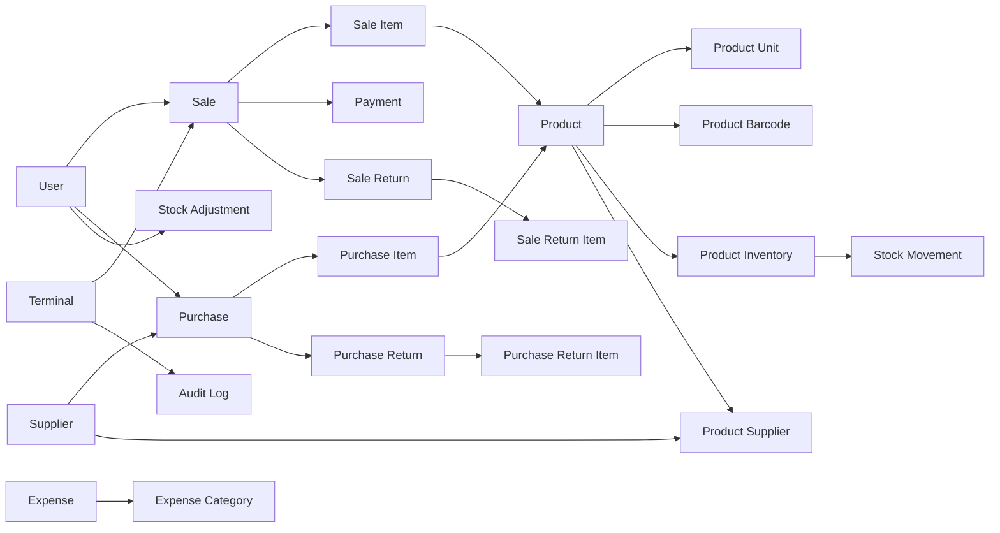
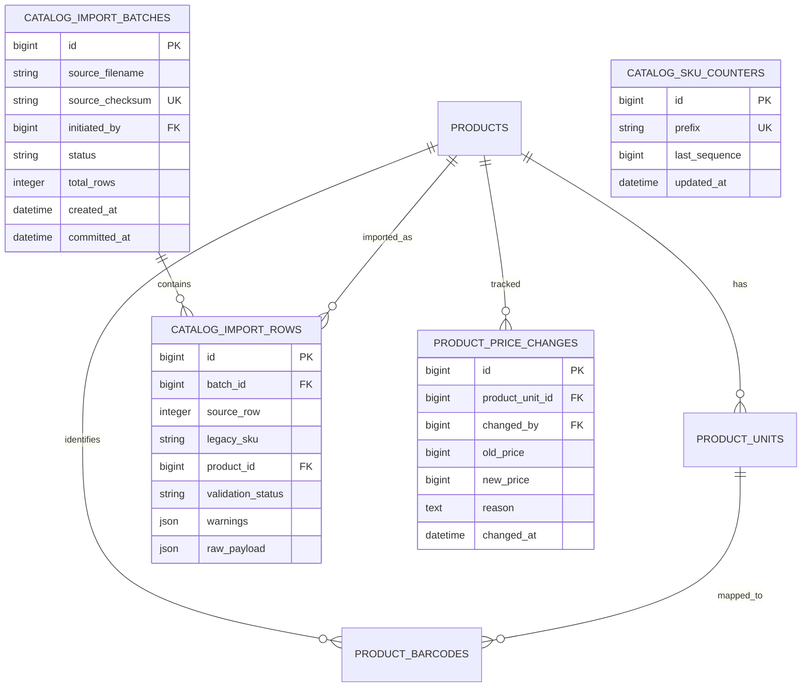

# ERD & Domain Model v1.3

**Project:** Retail POS & Inventory Management System  
**Status:** Draft for Technical Review  
**Basis:** PRD v1.3 + Critical Decisions v1.3 (Revisi 1–3)  
**Architecture:** Decoupled Monorepo, Laravel API, React SPA, Redis, Reverb/Echo  
**Scope:** Logical domain model. Belum merupakan physical Laravel migration final.

## Navigasi cepat

- [4. Logical ERD](#4-logical-erd)
- [5. Domain Detail](#5-domain-detail)
- [5.11 Safety Stock](#511-safety-stock--rop-revisi-2)
- [8. Invariants](#8-invariants)
- [10. Reporting](#10-reporting-source-of-truth--revisi-1)
- [12. Technical Decisions](#12-open-technical-decisions-setelah-erd)

## 1. Tujuan Dokumen

Dokumen ini mendefinisikan:

- domain utama sistem;
- entity inti;
- relasi antar-entity;
- data yang menjadi source of truth;
- aturan integritas utama;
- snapshot yang diperlukan untuk histori transaksi;
- batas antara transaksi, inventory ledger, dan reporting.

Prinsip desain:

1. Histori transaksi yang sudah finalized tidak diedit secara destruktif.
2. Inventory menggunakan **base unit** sebagai satuan penyimpanan.
3. `stock_movements` menjadi ledger perubahan stok.
4. Saldo stok terkini disimpan pada `product_inventory` sebagai current balance.
5. Harga/nama/satuan penting pada transaksi disimpan sebagai snapshot agar histori tidak berubah ketika master data berubah.
6. Offline sale menggunakan UUID dari client untuk idempotency.
7. Report dihitung dari transactional data, bukan disimpan sebagai tabel laporan terpisah.
8. Multi-company / multi-branch belum dimasukkan karena belum menjadi requirement MVP.

## 2. Bounded Context / Domain

Domain dibagi menjadi:

```text
Identity & Access
Company & Terminal
Product Catalog
Supplier & Purchasing
Inventory
Sales / POS
Payment
Returns & Corrections
Expense & Profit
Audit & Offline Sync
```

## 3. High-Level Domain Relationship



## 4. Logical ERD

```mermaid
erDiagram

    COMPANIES {
        bigint id PK
        string name
        text address
        string phone
        string logo_path
        datetime created_at
        datetime updated_at
    }

    USERS {
        bigint id PK
        string name
        string username
        string email
        string password
        boolean is_active
        datetime created_at
        datetime updated_at
    }

    ROLES {
        bigint id PK
        string name
        string code
    }

    PERMISSIONS {
        bigint id PK
        string name
        string code
    }

    USER_ROLES {
        bigint user_id FK
        bigint role_id FK
    }

    ROLE_PERMISSIONS {
        bigint role_id FK
        bigint permission_id FK
    }

    TERMINALS {
        bigint id PK
        uuid terminal_uuid UK
        string name
        string device_name
        boolean is_active
        datetime last_seen_at
    }

    CATEGORIES {
        bigint id PK
        string name
        boolean is_active
    }

    UNITS {
        bigint id PK
        string code
        string name
        boolean is_active
    }

    PRODUCTS {
        bigint id PK
        string sku UK
        string name
        string brand_name
        string rack_location
        bigint category_id FK
        string size
        string color
        string variant_label
        boolean is_active
        datetime created_at
        datetime updated_at
    }

    PRODUCT_UNITS {
        bigint id PK
        bigint product_id FK
        bigint unit_id FK
        decimal conversion_to_base
        decimal selling_price
        boolean is_base
        boolean is_active
    }

    PRODUCT_BARCODES {
        bigint id PK
        bigint product_id FK
        bigint product_unit_id FK
        string barcode UK
        string source
        string symbology
        boolean is_primary
        datetime created_at
    }

    SUPPLIERS {
        bigint id PK
        string code UK
        string name
        text address
        string city
        string phone
        boolean is_active
    }

    PRODUCT_SUPPLIERS {
        bigint id PK
        bigint product_id FK
        bigint supplier_id FK
        string supplier_product_code
        boolean is_active
    }

    PURCHASES {
        bigint id PK
        string purchase_no UK
        bigint supplier_id FK
        bigint recorded_by FK
        date purchased_at
        string supplier_invoice_no
        string status
        decimal subtotal
        decimal total
        decimal freight_in_amount
        decimal purchase_discount_amount
        datetime received_at
        datetime created_at
    }

    PURCHASE_ITEMS {
        bigint id PK
        bigint purchase_id FK
        bigint product_id FK
        bigint product_unit_id FK
        decimal quantity
        decimal base_quantity
        decimal unit_cost
        decimal base_unit_cost
        decimal allocated_freight_amount
        decimal allocated_discount_amount
        decimal landed_cost_total
        decimal subtotal
    }

    PURCHASE_ATTACHMENTS {
        bigint id PK
        bigint purchase_id FK
        string file_path
        string file_name
        string mime_type
    }

    PURCHASE_RETURNS {
        bigint id PK
        bigint purchase_id FK
        bigint supplier_id FK
        bigint created_by FK
        string return_no UK
        string status
        text reason
        datetime returned_at
    }

    PURCHASE_RETURN_ITEMS {
        bigint id PK
        bigint purchase_return_id FK
        bigint purchase_item_id FK
        bigint product_id FK
        decimal base_quantity
        decimal value
    }

    PRODUCT_INVENTORY {
        bigint id PK
        bigint product_id FK
        decimal quantity_base
        decimal average_cost
        decimal inventory_value
        datetime updated_at
    }

    STOCK_MOVEMENTS {
        bigint id PK
        bigint product_id FK
        bigint created_by FK
        bigint terminal_id FK
        string movement_type
        decimal quantity_delta_base
        decimal unit_cost
        decimal inventory_value_delta
        decimal inventory_value_after
        decimal quantity_after_base
        string reference_type
        bigint reference_id
        text notes
        datetime occurred_at
    }

    STOCK_ADJUSTMENTS {
        bigint id PK
        string adjustment_no UK
        bigint created_by FK
        string reason_type
        text notes
        datetime adjusted_at
    }

    STOCK_ADJUSTMENT_ITEMS {
        bigint id PK
        bigint stock_adjustment_id FK
        bigint product_id FK
        decimal before_quantity_base
        decimal adjustment_quantity_base
        decimal after_quantity_base
    }

    STOCK_OPNAMES {
        bigint id PK
        string opname_no UK
        bigint created_by FK
        string status
        datetime started_at
        datetime completed_at
    }

    STOCK_OPNAME_ITEMS {
        bigint id PK
        bigint stock_opname_id FK
        bigint product_id FK
        decimal system_quantity_base
        decimal physical_quantity_base
        decimal difference_base
    }

    PRODUCT_INVENTORY_POLICIES {
        bigint id PK
        bigint product_id FK
        decimal manual_reorder_point
        decimal manual_safety_stock_base
        integer lead_time_days
        decimal target_service_level
        integer demand_window_days
        integer minimum_history_days
        boolean auto_reorder_point_enabled
    }

    INVENTORY_POLICY_SETTINGS {
        bigint id PK
        integer moving_window_days
        decimal fast_percentile
        decimal middle_percentile
        datetime updated_at
    }

    SALES {
        bigint id PK
        uuid client_uuid UK
        string sale_no UK
        bigint cashier_id FK
        bigint terminal_id FK
        string status
        boolean created_offline
        decimal subtotal
        decimal discount_total
        decimal grand_total
        datetime completed_at
        datetime created_at
    }

    SALE_ITEMS {
        bigint id PK
        bigint sale_id FK
        bigint product_id FK
        bigint product_unit_id FK
        string sku_snapshot
        string product_name_snapshot
        string unit_name_snapshot
        decimal quantity
        decimal conversion_to_base_snapshot
        decimal base_quantity
        decimal unit_price
        decimal discount_amount
        decimal net_total
        decimal cost_per_base_snapshot
        decimal cost_total
    }

    PAYMENT_METHODS {
        bigint id PK
        string code UK
        string name
        boolean is_active
    }

    PAYMENTS {
        bigint id PK
        bigint sale_id FK
        bigint payment_method_id FK
        decimal amount
        string reference_no
        datetime paid_at
    }

    SALE_RETURNS {
        bigint id PK
        string return_no UK
        bigint sale_id FK
        bigint created_by FK
        string status
        text reason
        decimal total_value
        datetime returned_at
    }

    SALE_RETURN_ITEMS {
        bigint id PK
        bigint sale_return_id FK
        bigint sale_item_id FK
        bigint product_id FK
        decimal base_quantity
        decimal refund_value
    }

    REFUNDS {
        bigint id PK
        bigint sale_return_id FK
        bigint payment_method_id FK
        decimal amount
        string reference_no
        datetime refunded_at
    }

    EXPENSE_CATEGORIES {
        bigint id PK
        string name
        boolean is_active
    }

    EXPENSES {
        bigint id PK
        bigint expense_category_id FK
        bigint recorded_by FK
        date expense_date
        decimal amount
        string description
        string reference_no
        datetime created_at
    }

    AUDIT_LOGS {
        bigint id PK
        bigint user_id FK
        bigint terminal_id FK
        string action
        string auditable_type
        bigint auditable_id
        json old_values
        json new_values
        text reason
        datetime created_at
    }

    SYNC_CONFLICTS {
        bigint id PK
        uuid client_uuid
        bigint terminal_id FK
        string entity_type
        string conflict_type
        json payload
        string status
        text resolution_notes
        datetime created_at
        datetime resolved_at
    }

    COMPANIES ||--o{ TERMINALS : has

    USERS ||--o{ USER_ROLES : assigned
    ROLES ||--o{ USER_ROLES : contains
    ROLES ||--o{ ROLE_PERMISSIONS : grants
    PERMISSIONS ||--o{ ROLE_PERMISSIONS : included

    CATEGORIES ||--o{ PRODUCTS : groups
    PRODUCTS ||--o{ PRODUCT_UNITS : sold_as
    UNITS ||--o{ PRODUCT_UNITS : defines
    PRODUCTS ||--o{ PRODUCT_BARCODES : identified_by
    PRODUCT_UNITS o|--o{ PRODUCT_BARCODES : identifies_unit

    PRODUCTS ||--o{ PRODUCT_SUPPLIERS : sourced_from
    SUPPLIERS ||--o{ PRODUCT_SUPPLIERS : supplies

    SUPPLIERS ||--o{ PURCHASES : receives
    USERS ||--o{ PURCHASES : records
    PURCHASES ||--|{ PURCHASE_ITEMS : contains
    PRODUCTS ||--o{ PURCHASE_ITEMS : purchased
    PRODUCT_UNITS ||--o{ PURCHASE_ITEMS : purchased_as
    PURCHASES ||--o{ PURCHASE_ATTACHMENTS : has

    PURCHASES ||--o{ PURCHASE_RETURNS : may_have
    PURCHASE_RETURNS ||--|{ PURCHASE_RETURN_ITEMS : contains
    PURCHASE_ITEMS ||--o{ PURCHASE_RETURN_ITEMS : references

    PRODUCTS ||--|| PRODUCT_INVENTORY : balance
    PRODUCTS ||--o{ STOCK_MOVEMENTS : ledger
    USERS ||--o{ STOCK_MOVEMENTS : creates
    TERMINALS o|--o{ STOCK_MOVEMENTS : originates

    STOCK_ADJUSTMENTS ||--|{ STOCK_ADJUSTMENT_ITEMS : contains
    PRODUCTS ||--o{ STOCK_ADJUSTMENT_ITEMS : adjusts
    USERS ||--o{ STOCK_ADJUSTMENTS : creates

    STOCK_OPNAMES ||--|{ STOCK_OPNAME_ITEMS : contains
    PRODUCTS ||--o{ STOCK_OPNAME_ITEMS : counted
    USERS ||--o{ STOCK_OPNAMES : creates

    PRODUCTS ||--o| PRODUCT_INVENTORY_POLICIES : policy

    USERS ||--o{ SALES : cashier
    TERMINALS ||--o{ SALES : created_on
    SALES ||--|{ SALE_ITEMS : contains
    PRODUCTS ||--o{ SALE_ITEMS : sold
    PRODUCT_UNITS ||--o{ SALE_ITEMS : sold_as

    SALES ||--|{ PAYMENTS : paid_by
    PAYMENT_METHODS ||--o{ PAYMENTS : method

    SALES ||--o{ SALE_RETURNS : may_have
    SALE_RETURNS ||--|{ SALE_RETURN_ITEMS : contains
    SALE_ITEMS ||--o{ SALE_RETURN_ITEMS : references

    SALE_RETURNS ||--o{ REFUNDS : refunds
    PAYMENT_METHODS ||--o{ REFUNDS : method

    EXPENSE_CATEGORIES ||--o{ EXPENSES : categorizes
    USERS ||--o{ EXPENSES : records

    USERS ||--o{ AUDIT_LOGS : performs
    TERMINALS o|--o{ AUDIT_LOGS : occurs_on

    TERMINALS ||--o{ SYNC_CONFLICTS : produces
```



## 5. Domain Detail

### 5.1 Identity & Access

#### `users`

Merepresentasikan akun pengguna sistem.

Field penting:

- `name`
- `username`
- `email`
- `password`
- `is_active`

Catatan:

- Sistem belum perlu menyimpan employee profile kompleks.
- User dapat mempunyai satu atau lebih role jika dibutuhkan.
- Role awal: owner, manager, supervisor, cashier.

#### `roles`

#### `permissions`

#### `user_roles`

#### `role_permissions`

RBAC digunakan agar permission tidak di-hardcode pada frontend/backend.

Contoh permission:

```text
product.view
product.create
product.update
product.change_price

inventory.view
inventory.adjust
inventory.stock_opname

sale.create
sale.return
sale.reprint

cash_drawer.open_manual

report.sales.view
report.profit.view
```

Permission final tidak perlu disimpan sebagai enum di source code bisnis.

### 5.2 Company

#### `companies`

Menyimpan identitas toko:

- nama;
- alamat;
- nomor telepon;
- logo.

Untuk MVP diasumsikan satu company profile per installation.

> Multi-tenant SaaS dan multi-branch tidak dimasukkan ke ERD v1.0 karena belum menjadi requirement client.

### 5.3 Terminal

#### `terminals`

Terminal mewakili perangkat kasir.

Dibutuhkan karena:

- transaksi dapat dibuat offline;
- client UUID membutuhkan asal terminal;
- manual cash drawer open perlu diketahui perangkatnya;
- konflik sync perlu diketahui asal perangkat.

`terminal_uuid` dibuat saat terminal pertama kali diregistrasikan.

### 5.4 Product Catalog

#### `products`

Satu row adalah satu sellable SKU.

Contoh:

```text
SKU: SEP-001-38-BLK
Name: Sepatu Sekolah
Size: 38
Color: Black
```

Pendekatan ini dipilih agar data legacy yang sudah mempunyai kode item unik tetap mudah dimigrasikan.

Tidak dibuat `product_variants` terpisah pada MVP.

Jika di masa depan diperlukan grouping varian, dapat ditambahkan `product_group_id` tanpa mengubah transaksi historis.

#### `categories`

Kategori produk.

#### `units`

Master satuan global:

```text
PCS
PACK
DUS
PASANG
ROLL
SETEL
```

#### `product_units`

Mendefinisikan cara satu SKU dijual.

Contoh:

```text
Product: Pulpen A

PCS
conversion_to_base = 1
selling_price = 5.000

PACK
conversion_to_base = 12
selling_price = 55.000

DUS
conversion_to_base = 144
selling_price = 600.000
```

Setiap product harus memiliki tepat satu `is_base = true`.

Inventory selalu disimpan menggunakan base unit.

#### `product_barcodes`

Revisi 4: kolom `source` (`FACTORY`, `SYSTEM`, `LEGACY_UNVERIFIED`) dan `symbology` (`CODE128`, `EAN13`, `UNKNOWN`, dst.) membantu pemilahan data. `barcode` selalu text, bukan angka. Satu kode barcode unik global; FK `product_unit_id` harus menunjuk unit milik `product_id` yang sama.


Barcode dipisahkan dari product agar sistem dapat mendukung:

- satu barcode utama;
- beberapa barcode;
- barcode untuk unit tertentu.

Jika barcode hanya satu per SKU pada data client, cukup dibuat satu record.

### 5.5 Supplier

#### `suppliers`

Master supplier.

#### `product_suppliers`

Many-to-many relationship:

```text
Product
   ↕
Supplier
```

Satu produk dapat berasal dari banyak supplier.

#### Riwayat harga supplier

Tidak dibuat tabel `supplier_price_histories` terpisah pada MVP.

Actual supplier price history dapat diperoleh dari:

```text
purchase_items
→ purchase
→ supplier
```

Ini menghindari duplikasi data.

Jika nantinya toko ingin menyimpan quotation supplier tanpa melakukan pembelian, barulah diperlukan tabel quotation/price-list terpisah.

### 5.6 Purchasing

#### `purchases`

Header pembelian dengan status `draft`, `received`, `cancelled`. Biaya angkut untuk pengadaan stok dicatat pada `freight_in_amount` dan potongan pemasok pada `purchase_discount_amount`. `received_at` adalah tanggal pengakuan pembelian dalam laporan persediaan. Tanggal invoice `purchased_at` tidak otomatis berarti penerimaan fisik.

`subtotal` = nilai bruto barang; `total` = nilai bruto + freight-in - discount (sebelum retur yang dicatat di transaksi terpisah). Semua nilai uang persisten dalam integer Rupiah untuk amount; rate dan alokasi internal menggunakan presisi decimal jika diperlukan.

#### `purchase_items`

Setiap baris menyimpan product, unit, quantity, base quantity, unit cost, subtotal, serta `allocated_freight_amount`, `allocated_discount_amount` dan `landed_cost_total` yang menghasilkan biaya perolehan unit/baris setelah alokasi.

Usulan pembagian biaya tingkat invoice: proporsional nilai barang sebelum diskon; selisih pembulatan dialokasikan deterministik sehingga jumlah alokasi tepat sama dengan total header. Alokasi final masih membutuhkan sign-off.

Saat purchase `received`, dalam satu database transaction:

1. Terima jumlah aktual, bukan hanya angka draft;
2. Validasikan total landed cost invoice dan setiap item;
3. Buat stock movement berikut dampak valuation;
4. Update `product_inventory.quantity_base` dan `inventory_value`, lalu average cost jika metode tersebut disetujui;
5. Emit event setelah commit dan tandai `received_at`.

**Pembelian periode = penerimaan yang benar-benar diproses pada periode tersebut**; draft, pembelian dibatalkan, dan tanggal invoice tanpa receipt tidak masuk pembelian bersih.

#### `purchase_attachments`

Invoice supplier disimpan sebagai path/metadata, bukan blob binary database.

### 5.7 Purchase Return

#### `purchase_returns`

#### `purchase_return_items`

Digunakan jika barang pembelian dikembalikan ke supplier.

Return tidak menghapus purchase asli.

Return menghasilkan negative stock movement.

### 5.8 Inventory

#### `product_inventory`

Current balance: `product_id`, `quantity_base`, `inventory_value` (integer IDR total carrying value), dan `average_cost` (rate dengan presisi decimal internal, bila metode moving average dipilih).

Persediaan harus memiliki nilai moneter **pada tanggal tertentu**, tidak hanya jumlah item. Nilai historis tidak boleh dihitung ulang dari `average_cost` terkini.

#### `stock_movements`

Ledger per produk memuat `quantity_delta_base`, `inventory_value_delta` (signed integer Rupiah), `quantity_after_base`, `inventory_value_after`, biaya unit/rate internal, `movement_type`, `reference_type`, `reference_id`, `occurred_at`. Semua inventory write menghasilkan movement dan update balance atomik.

Jenis movement tetap mencakup `PURCHASE_RECEIVE`, `PURCHASE_RETURN`, `SALE`, `SALE_RETURN`, `STOCK_ADJUSTMENT`, `STOCK_OPNAME`, `DAMAGED`, `LOST`, serta `OPENING_BALANCE` untuk onboarding/migrasi stok awal.

**Cutoff sejarah:** nilai persediaan pada akhir tanggal = total carrying value dari movement terakhir tiap produk pada atau sebelum cutoff (atau snapshot historis terverifikasi jika ditambahkan untuk performa). Nilai awal suatu periode = nilai akhir hari sebelumnya. Timezone dan penanganan late-posting harus konsisten; koreksi periode lama tidak boleh dilakukan secara destruktif.

**Pergerakan stok non-penjualan:** biaya inventory yang berubah karena kerusakan, kehilangan, selisih opname, atau adjustment tidak otomatis menjadi HPP penjualan. Simpan movement value dan reason untuk rekonsiliasi finansial (CD-019). Laporan periode tersebut berstatus `requires_review` bila kebijakan pengakuannya belum final.

### 5.9 Stock Adjustment

#### `stock_adjustments`

#### `stock_adjustment_items`

Digunakan untuk:

- correction;
- barang rusak;
- barang hilang;
- stok fisik ada tetapi sistem salah.

Adjustment harus memiliki reason.

Setiap item menghasilkan `stock_movements`.

### 5.10 Stock Opname

#### `stock_opnames`

#### `stock_opname_items`

Flow:

```text
Start Opname
→ Catat system quantity
→ Input physical quantity
→ Hitung difference
→ Complete
→ Generate stock movement adjustment
```

Histori opname tidak boleh berubah setelah completed.

### 5.11 Safety Stock & ROP (Revisi 2)

#### `product_inventory_policies`

Policy per produk menyimpan **konfigurasi** berikut (bukan hasil kalkulasi dinamis):

```text
product_id                  UNIQUE FK -> products.id
lead_time_days              INTEGER > 0
target_service_level         DECIMAL (0 < x < 1; contoh 0.95)
demand_window_days          INTEGER > 0
minimum_history_days        INTEGER > 0 dan <= demand_window_days
manual_safety_stock_base    DECIMAL nullable
manual_reorder_point        DECIMAL nullable
auto_reorder_point_enabled  BOOLEAN
```

Seluruh jumlah memakai **base unit**. `safety_days` dari model v1.1 tidak lagi dipakai pada perhitungan statistik; rencanakan migrasi policy jika sudah ada data tersimpan.

**Sumber data untuk metrik demand:** `sales` yang completed dan `sale_items.base_quantity`, diagregasi menurut **business date** dan timezone toko. Hari tanpa sale tetap bernilai `0`, bukan dikeluarkan dari rata-rata. Perubahan nilai demand akibat retur, koreksi sale, atau sinkronisasi offline terlambat belum ditentukan dokumen contoh dan harus disepakati; jangan diam-diam memperlakukan semua retur sebagai permintaan negatif.

**Simpangan baku:** gunakan simpangan baku **populasi** dari jendela observasi yang disepakati (bukan sample SD), agar hasil antar-developer/reports konsisten. `lead_time_days` dianggap tetap. Gunakan presisi internal memadai untuk mean, SD, dan `sqrt` sebelum pembulatan quantity.

```text
SS_raw  = Z(target_service_level) × σd × √L
SS_base = ceil_to_base_unit_step(SS_raw)
ROP_raw = (average_daily_demand_base × L) + SS_base
ROP     = ceil_to_base_unit_step(ROP_raw)
```

Untuk produk diskret seperti buku tulis, unit step = 1 PCS. Untuk produk pecahan, step mengikuti presisi dasar valid dari produk. Perhitungan raw dan rounding harus bisa ditelusuri dalam response.

**Metrik runtime (derived, tidak wajib tabel baru):** `average_daily_demand_base`, `stddev_daily_demand_base`, `z_score`, `safety_stock_base`, `reorder_point_base`, `calculation_status`, `calculated_at`. Nilai dapat di-cache dan di-refresh setelah transaksi/perubahan policy. Cache **bukan** source of truth; status dan nilai histori penjualan tetap dihitung dari data domain.

**Kondisi data tidak cukup:** gunakan `manual_reorder_point` (dan manual SS jika tersedia) sebagai fallback dengan `calculation_status=manual_fallback`; jika tidak ada fallback, `calculation_status=insufficient_history` dan `stock_status=insufficient_data` (kecuali stok 0, tetap Habis). Backend tidak menganggap histori hilang sama dengan permintaan nol.

**Klasifikasi urut dan mutually exclusive:**

```text
stock = 0         -> out_of_stock
0 < stock <= SS   -> critical
SS < stock <= ROP -> reorder_needed
stock > ROP       -> sufficient
missing threshold -> insufficient_data
```

Jika fallback hanya memiliki manual ROP tanpa SS, backend dapat menandai `reorder_needed` saat `stock <= ROP` dan `sufficient` saat di atasnya, tetapi **tidak** mengklaim `critical` tanpa SS yang valid. `stock = 0` selalu `out_of_stock`.

**Tidak** menghitung overstock dari SS/ROP; kebijakan stok maksimum merupakan fitur terpisah.

#### `inventory_policy_settings`

Tetap digunakan untuk **slow/middle/fast moving classification**, bukan untuk menggantikan parameter SS/ROP per produk. Default proposal jendela 90 hari, percentile 20/30/50 dapat diubah melalui settings.

### 5.12 Sales / POS

#### `sales`

Sale header.

Field penting:

```text
client_uuid
sale_no
cashier_id
terminal_id
status
created_offline
subtotal
discount_total
grand_total
completed_at
```

#### `client_uuid`

Dibuat oleh frontend/terminal sebelum transaksi dikirim ke backend.

Digunakan untuk:

- offline sync;
- retry;
- duplicate prevention;
- idempotency.

`client_uuid` harus unique.

### Sale Status

Recommended state:

```text
draft
pending_payment
completed
cancelled
pending_sync     // local/client state
sync_conflict    // conflict state
```

Catatan:

`pending_sync` secara konsep lebih relevan pada local client database.

Backend menyimpan completed sale setelah sync berhasil, atau conflict record jika sync gagal.

### 5.13 Sale Item Snapshot

#### `sale_items`

Sale item tidak boleh bergantung sepenuhnya pada master product.

Snapshot diperlukan karena product dapat berubah setelah transaksi.

Disimpan:

```text
sku_snapshot
product_name_snapshot
unit_name_snapshot
conversion_to_base_snapshot
unit_price
cost_per_base_snapshot
```

Contoh:

Jika hari ini:

```text
Pulpen A = Rp5.000
```

dan bulan depan berubah menjadi:

```text
Pulpen A = Rp6.000
```

laporan transaksi bulan lalu tetap menunjukkan Rp5.000.

`cost_total` digunakan untuk menghitung gross profit transaksi historis.

### 5.14 Payment

#### `payment_methods`

Seed awal:

```text
CASH
QRIS
```

Model berupa table, bukan hardcoded enum, agar dapat diperluas jika kebutuhan berubah.

#### `payments`

One sale dapat memiliki banyak payment.

Contoh split payment:

```text
Sale Total = 100.000

Payment 1
CASH = 40.000

Payment 2
QRIS = 60.000
```

Invariant:

```text
SUM(payments.amount) == sales.grand_total
```

untuk sale `completed`.

### 5.15 Sale Return / Correction

#### `sale_returns`

#### `sale_return_items`

Finalized sale tidak diedit secara destruktif.

Return mereferensikan:

```text
original sale
original sale item
```

Return menghasilkan:

```text
positive stock movement
```

untuk barang yang kembali menjadi sellable stock.

Jika barang retur rusak, return dapat diikuti damaged adjustment sesuai workflow.

### 5.16 Refund

#### `refunds`

Memungkinkan refund menggunakan metode pembayaran.

Contoh:

```text
Original:
Cash = 40.000
QRIS = 60.000

Refund:
Cash = 10.000
```

Detail policy refund bisnis dapat dikembangkan kemudian.

### 5.17 Expense & Net Profit

#### `expense_categories` dan `expenses`

`expenses` mencatat biaya operasional periode (mis. gaji, listrik, internet, transport non-pengadaan) berdasarkan `expense_date`, `amount`, `category`, `description`, `reference`, `recorded_by`.

**Freight-in pengadaan stok tidak masuk `expenses`.** Nilai tersebut masuk `purchases.freight_in_amount` dan dialokasikan pada carrying cost persediaan. Validasi UI/API harus melindungi dari pencatatan ganda. Jika ada pajak/bunga/non-operasional kelak, perlu perluasan model laporan; dokumen referensi saat ini menggunakan laba kotor - beban operasional sebagai laba bersih.

Urutan perhitungan periodik dan rekonsiliasi dijelaskan pada bagian 10.

### 5.18 Audit Log

#### `audit_logs`

Digunakan untuk perubahan sensitif.

Minimal:

```text
price change
manual cash drawer open
stock-sensitive administrative changes
```

Struktur:

```text
user
terminal
action
target entity
old values
new values
reason
timestamp
```

Audit log harus append-only dari perspektif aplikasi normal.

### 5.19 Offline Sync Conflict

#### `sync_conflicts`

Backend menyimpan transaksi offline yang tidak dapat diproses otomatis.

Contoh conflict:

```text
INSUFFICIENT_STOCK
DUPLICATE_UUID
PRODUCT_INACTIVE
INVALID_PRICE_VERSION
UNKNOWN_UNIT
```

Status:

```text
open
resolved
ignored
```

Jangan menghapus payload conflict sebelum resolved.

### 5.20 Terminal Peripheral Configuration & Device Commands (Revisi 3)

Perangkat nyata pada instalasi pertama: printer KASSEN/BT-P299 58 mm USB/Bluetooth ESC/POS, cash drawer CD-339, scanner PANDA USB, Windows PC. Ini **inventory hardware**, bukan jaminan driver/port bekerja dengan SIPINTAR.

#### `terminal_peripheral_profiles` (logical entity, satu profile aktif per terminal)

| Field | Tipe logical | Keterangan |
| --- | --- | --- |
| `id` | bigint PK | ID profile |
| `terminal_id` | bigint FK | Ke `terminals.id`, indexed |
| `receipt_printer_model` | string nullable | `BT-P299` saat diverifikasi |
| `receipt_width_mm` | integer | `58` untuk instalasi awal |
| `receipt_transport` | enum | `usb`, `bluetooth`, `unknown` |
| `receipt_protocol` | string nullable | `escpos` jika telah diuji |
| `drawer_model` | string nullable | `CD-339` dari label |
| `drawer_trigger_path` | enum | `via_printer`, `direct`, `unknown` |
| `scanner_brand` | string nullable | `PANDA` |
| `scanner_input_mode` | enum | `usb_hid`, `other`, `unknown` |
| `capability_verified_at` | datetime nullable | Hasil smoke test aktual |
| `updated_at` | datetime | Metadata konfigurasi |

Port identifier, driver secrets, auth agent dan device path rahasia tetap di **local secure config**, bukan dalam response API publik. Untuk instalasi satu terminal, profil bisa disimpan di konfigurasi agent terlebih dahulu; entity ini adalah model logical bila dibutuhkan server-side management, **bukan migration wajib MVP**.

#### `peripheral_events` (append-only logical audit entity)

| Field | Tipe logical | Keterangan |
| --- | --- | --- |
| `id` | bigint PK | Event internal |
| `event_uuid` | uuid UNIQUE | Idempotensi audit/sync |
| `command_uuid` | uuid | Identitas perintah lokal; retry/reprint membuat attempt tercatat |
| `terminal_id` | bigint FK | Perangkat asal |
| `user_id` | bigint FK nullable | Kasir / operator |
| `sale_id` | bigint FK nullable | Sale yang ada di server, bila tersedia |
| `client_uuid` | uuid nullable | Offline sale reference |
| `peripheral_type` | enum | `receipt_printer`, `cash_drawer`, `barcode_scanner` |
| `action` | enum | `print_receipt`, `reprint_receipt`, `open_auto`, `open_manual`, `scan_test` |
| `outcome` | enum | `command_sent`, `failed`, `unknown` |
| `source` | enum | `pos`, `manual_ui`, `test` |
| `error_code` | string nullable | Sanitized adapter error |
| `occurred_at` | datetime | Device time dengan timezone |
| `created_at` | datetime | Server ingested time |

`command_sent` **tidak** berarti laci telah terbuka (sensor fisik belum tersedia). Domain `SALE` dan pembayaran adalah aggregate terpisah dari perintah perangkat; sale tidak diubah bila command gagal. Audit `manual_open` lama dapat dipertahankan untuk backward compatibility, tetapi server harus mencegah duplicate log untuk satu peristiwa.

**Boundary key requirement:** saat offline, sale `pending_sync` memiliki UUID client yang durable; mengulang sync transaksi tidak mengulang command drawer/print. Status command `unknown` tidak boleh di-auto-retry untuk drawer; UI memberikan instruksi untuk rekonsiliasi operator.

**Aturan trigger pembaruan v1.3 (domain invariant):** ketika satu `SALE` sudah **completed dan durable**, buat maksimal **satu** perintah otomatis `cash_drawer.open_auto` untuk sale tersebut, **terlepas dari metode pembayaran** (`CASH`, `QRIS`, atau gabungan). QRIS yang belum dikonfirmasi tidak boleh membuat sale `completed`. Jangan memicu dari tiap baris `PAYMENTS`, reprint, refund, query receipt, maupun percobaan ulang sinkronisasi. Implementasi lokal menyimpan `command_uuid`/status secara durable dan melakukan deduplikasi berdasarkan identitas sale; tidak diperlukan perubahan entitas payment untuk aturan ini.

## 6. Core Transaction Flows

### 6.1 Sale

```text
Product Search
      ↓
Select Product Unit
      ↓
Add Sale Item
      ↓
Calculate Total
      ↓
Create Payments
      ↓
Finalize Sale
      ↓
Create Stock Movements
      ↓
Update Product Inventory
      ↓
Persist Sale Cost Snapshot
      ↓
Commit Sale / send success to local POS
      ↓
Store receipt + drawer device command UUIDs durably
      ↓
Print Receipt (independent device command)
      ↓
Open Cash Drawer once for any completed sale (CASH / QRIS / split)
      ↓
Audit command result (no sale rollback on peripheral failure)
```

### 6.2 Purchase Receive

```text
Select Supplier
      ↓
Add Purchase Items
      ↓
Receive Purchase (actual quantity + received_at)
      ↓
Allocate Freight-in and Purchase Discount
      ↓
Validate Landed Cost per Purchase Item
      ↓
Create Quantity + Value Stock Movements
      ↓
Update Inventory Quantity + Inventory Value
      ↓
Update Unit Cost If Valuation Method Approved
      ↓
Store Invoice Attachment
```

### 6.3 Stock Adjustment

```text
Select Product
      ↓
Input Adjustment
      ↓
Select Reason
      ↓
Create Adjustment Item
      ↓
Create Stock Movement
      ↓
Update Inventory Balance
```

### 6.4 Sale Return

```text
Open Original Sale
      ↓
Select Sale Item
      ↓
Select Return Quantity
      ↓
Create Sale Return
      ↓
Create Stock Movement
      ↓
Create Refund if needed
      ↓
New Sale if Exchange
```

## 7. Aggregate Roots

Untuk Laravel service/application layer, aggregate root yang disarankan:

```text
Product
Supplier
Purchase
Sale
SaleReturn
PurchaseReturn
StockAdjustment
StockOpname
Expense
```

Child entity tidak dimodifikasi langsung dari controller tanpa melalui aggregate/service yang sesuai.

Contoh:

```text
Purchase
└── PurchaseItems

Sale
├── SaleItems
└── Payments

StockOpname
└── StockOpnameItems
```

## 8. Invariants

### INV-001

`products.sku` harus unique.

### INV-002

`product_barcodes.barcode` harus unique jika terisi.

### INV-003

Setiap product harus mempunyai tepat satu base product unit.

### INV-004

`conversion_to_base > 0`.

### INV-005

Inventory tidak boleh menjadi negatif akibat sale normal.

### INV-006

Setiap perubahan inventory harus menghasilkan stock movement.

### INV-007

Completed sale tidak dapat diedit secara destruktif.

### INV-008

Completed purchase tidak dapat diedit secara destruktif tanpa correction/return.

### INV-009

Untuk completed sale:

```text
sum(payment.amount) = grand_total
```

### INV-010

`client_uuid` sale harus unique.

### INV-011

Sale item harus menyimpan price dan cost snapshot.

### INV-012

Product master price changes tidak boleh mengubah historical sale.

### INV-013

Stock opname completed tidak dapat diubah langsung.

### INV-014

Manual cash drawer open harus menghasilkan audit event.

### INV-015 — Persediaan Historis

Setiap stock movement mempunyai perubahan nilai inventory dan saldo nilai setelah movement, sehingga nilai awal/akhir periode dapat direproduksi dan diaudit.

### INV-016 — Biaya Pengadaan

Biaya angkut pembelian dan potongan pembelian masuk cost allocation penerimaan barang serta tidak boleh dimasukkan kembali sebagai operating expense.

### INV-017 — Rekonsiliasi Laporan

Jika terdapat inventory movement non-penjualan yang belum dipetakan secara finansial, laporan laba rugi memberi status membutuhkan review, bukan mengklaim HPP akurat tanpa catatan.

### INV-018 — Safety Stock Determinism (Revisi 2)

Setiap kalkulasi SS/ROP memiliki parameter, periode data, Z-score, asumsi unit, dan waktu kalkulasi yang jelas; input identik menghasilkan output sama.

### INV-019 — Inventory Threshold Partition (Revisi 2)

Untuk SS/ROP efektif yang valid, satu produk tepat memiliki satu dari status `out_of_stock`, `critical`, `reorder_needed`, atau `sufficient`; batas SS dan ROP inklusif sesuai CD-004.

### INV-020 — Data Sufficiency & Permission

Metrik dari histori yang tidak mencukupi tidak boleh direpresentasikan sebagai perhitungan statistik final. Perubahan policy wajib melalui permission backend dan audit log.

## 9. Recommended Indexes

Physical migration nanti minimal mempertimbangkan:

```text
products.sku UNIQUE
product_barcodes.barcode UNIQUE
suppliers.code UNIQUE

sales.client_uuid UNIQUE
sales.sale_no UNIQUE
sales.completed_at INDEX
sales.cashier_id INDEX
sales.terminal_id INDEX

purchase.purchase_no UNIQUE
purchase.supplier_id INDEX
purchase.purchased_at INDEX
purchases.received_at INDEX

stock_movements.product_id INDEX
stock_movements.occurred_at INDEX
stock_movements(product_id, occurred_at, id) INDEX
stock_movements(reference_type, reference_id) INDEX
product_inventory_policies.product_id UNIQUE
sale_items(sale_id, product_id) INDEX
sale_returns.returned_at INDEX

sale_items.product_id INDEX
purchase_items.product_id INDEX

product_suppliers(product_id, supplier_id) UNIQUE

product_units(product_id, unit_id) UNIQUE

payments.sale_id INDEX

audit_logs(user_id, created_at) INDEX

sync_conflicts(client_uuid) INDEX
sync_conflicts(status) INDEX
```

Final indexes harus disesuaikan dengan query nyata setelah API contract dibuat.

## 10. Reporting Source of Truth — Revisi 1

Report dihitung dari transactional source data, bukan mengubah transaksi historis menjadi tabel `daily_sales_report` atau `profit_report`.

### Profit & Loss Periode

```text
Gross Purchases       = SUM(purchase_items.subtotal untuk receipts final)
Freight-in            = SUM(purchases.freight_in_amount untuk receipts final)
Purchase Returns      = SUM(purchase_return_items.value untuk returns final)
Purchase Discounts    = SUM(purchases.purchase_discount_amount untuk receipts final)
Net Purchases         = Gross Purchases + Freight-in
                        - Purchase Returns - Purchase Discounts

Opening Inventory     = SUM(nilai persediaan per produk as-of H-1)
Ending Inventory      = SUM(nilai persediaan per produk as-of H)
Goods Available       = Opening Inventory + Net Purchases
Periodic COGS         = Goods Available - Ending Inventory

Gross Sales           = SUM(hasil sale completed sebelum retur/potongan)
Sales Returns         = SUM(sale_return_items.refund_value untuk returns final)
Sales Discounts       = SUM(diskon yang mengurangi penjualan bruto)
Net Sales             = Gross Sales - Sales Returns - Sales Discounts
Gross Profit          = Net Sales - Periodic COGS
Operating Expenses    = SUM(expenses.amount untuk periode)
Net Profit            = Gross Profit - Operating Expenses
```

**Catatan diskon penjualan:** `gross_sales` harus didefinisikan **sebelum** diskon, supaya `sales_discounts` tidak dikurangkan dua kali. `sale_items.net_total` umumnya sudah setelah diskon; jangan digunakan untuk gross sales tanpa rekonstruksi.

**Catatan retur penjualan:** refund nilai uang tidak sama dengan pembalikan HPP; nilai stok yang kembali harus diproses terpisah pada inventory ledger. Pastikan retur lintas-periode tercatat pada tanggal efektif dan menghasilkan nilai ending inventory yang benar.

**Catatan variance:** rumus referensi di atas persis pada skenario normal tanpa stok hilang/rusak/adjustment. Pergerakan nilai non-penjualan perlu rekonsiliasi ke akun biaya/pendapatan terkait sebelum angka disebut HPP penjualan; tampilkan `reconciliation_status=requires_review` sampai kebijakannya disetujui.

### Golden Case ATK INSAN — Januari 2026

| Komponen           | Rp             |
| ------------------ | -------------: |
| Opening Inventory  | 8.000.000      |
| Gross Purchases    | 5.000.000      |
| Freight-in         | 200.000        |
| Purchase Returns   | 100.000        |
| Purchase Discounts | 50.000         |
| Net Purchases      | **5.050.000**  |
| Goods Available    | 13.050.000     |
| Ending Inventory   | 3.000.000      |
| Periodic COGS      | **10.050.000** |
| Gross Sales        | 16.000.000     |
| Sales Returns      | 200.000        |
| Sales Discounts    | 100.000        |
| Net Sales          | **15.700.000** |
| Gross Profit       | **5.650.000**  |
| Operating Expenses | 1.700.000      |
| Net Profit         | **3.950.000**  |

### Historical Valuation Invariants

`product_inventory.inventory_value` adalah saldo terbaru dan **tidak** cukup untuk menghitung nilai historis. `stock_movements.inventory_value_after` per produk harus memungkinkan kueri point-in-time. Gunakan `occurred_at`, `id` sequence order yang stabil, serta data opening balance yang terverifikasi. Bila dibuat performance snapshot, snapshot bukan *new source of truth*; harus dapat direkonsiliasi dengan ledger.

### Operational Gross Profit vs Periodic Financial COGS

Sale item snapshot cost dapat membantu analisis margin transaksi. Tetapi laba rugi periode menggunakan periodic COGS yang direkonsiliasi; tidak boleh menjumlah biaya item lalu menguranginya lagi dari hasil periodik.

## 11. Entity yang Tidak Dibuat pada MVP

Belum dibuat:

```text
Customers
Customer Members
Accounts Receivable
Supplier Payables
Tax / VAT
Marketplace Orders
Branches
Warehouses
Purchase Orders
Supplier Quotations
Complex Promotions
Loyalty Points
```

Alasan:

Belum menjadi requirement confirmed.

## 12. Open Technical Decisions Setelah ERD

ERD ini cukup untuk masuk ke API Contract, tetapi masih ada technical decisions:

### TD-001 — Database Engine

Pilih:

```text
PostgreSQL
atau
MySQL
```

### TD-002 — Money Data Type

Harus diputuskan apakah menggunakan:

```text
BIGINT minor unit
```

atau:

```text
DECIMAL
```

Rekomendasi untuk rupiah tanpa pecahan pada transaksi retail:

```text
BIGINT integer Rupiah
```

tetapi keputusan final harus konsisten pada seluruh API/backend/frontend.

### TD-003 — Offline Local Database

React offline layer perlu memilih:

```text
IndexedDB
```

langsung atau menggunakan wrapper seperti Dexie.

### TD-004 — Hardware Agent

**Bukti fisik tersedia** untuk KASSEN BT-P299 58 mm ESC/POS, cash drawer CD-339 (auto open pada POS lama), dan PANDA USB scanner. **Masih perlu proof-of-concept** agent Windows, USB print, pulse drawer dan penanganan koneksi putus. Local loopback agent adalah arah desain yang akan diuji, bukan final implementation.

### TD-005 — Expense Category

Owner perlu memberikan kategori biaya operasional yang ingin dihitung sebagai laba bersih.

### TD-006 — Metode Valuasi Persediaan

HPP periodik memakai rumus referensi terbaru. Moving Weighted Average untuk **nilai unit persediaan** masih perlu konfirmasi accounting/owner.

### TD-007 — Landed Cost & Stock Variance

Tentukan metode alokasi freight-in/diskon, presisi/pembulatan, perlakuan nilai barang rusak/hilang, koreksi stok/opname, dan retur lintas-periode sebelum financial go-live.

### TD-008 — Peripheral Logging & Idempotency

Desain `peripheral_events` harus menjaga `event_uuid` UNIQUE, `command_uuid` untuk traceability, dan memisahkan `sale.client_uuid` dari command retries. Profil device adalah logical model opsional; jangan jadikan port/device secret sebagai bagian public API.

## Revisi 4 — Master Data, Identitas Produk, dan Import Ledger

### 1. Struktur Identitas dan Barcode

- Pertahankan `products.sku` lama yang unik. Alokasi SKU baru menggunakan tabel/sequence `catalog_sku_counters` atau DB sequence atomik, dengan kunci `scope/prefix`; jangan generate SKU dengan query maksimum tanpa lock.
- `products.brand_name` dan `products.rack_location` merupakan field opsional guna mempertahankan `MEREK` dan `RAK`. Normalisasi merek ke master `brands` dapat dipertimbangkan setelah cleaning.
- `product_barcodes.source` membedakan `FACTORY`, `SYSTEM`, `LEGACY_UNVERIFIED`; `symbology` membedakan `CODE128`, `EAN13`, `UNKNOWN` dan yang valid. Batasi perubahan dan hapus mapping lewat audit; barcode yang pernah dipakai transaksi tidak dibuang secara destruktif.
- Gunakan `product_unit_id` untuk identitas satuan hasil scan. Pada permintaan create produk + beberapa satuan yang belum mempunyai DB ID, frontend dapat mengirim `units[].client_key` dan `barcodes[].unit_client_key` agar backend menyelesaikan FK setelah membuat unit dalam satu transaksi.
- Harga jual valid untuk sale harus bernilai positif. Legacy `selling_price=0` bisa diimpor sebagai *unpriced*, tetapi bukan harga penjualan Rp0.

### 2. Domain Tambahan (Logical)



`CATALOG_IMPORT_BATCHES`/`CATALOG_IMPORT_ROWS` adalah usulan staging/audit untuk import terkontrol; tidak diperlukan untuk proses scan kasir biasa. Indeks unik wajib `products.sku`, `product_barcodes.barcode`, `catalog_import_rows(batch_id, source_row)`; `source_checksum` dapat menjadi anti-duplikasi impor berdasarkan kebijakan batch.

### 3. Pemetaan Excel → Domain

| Source Excel | Destination | Treatment |
| --- | --- | --- |
| `KODEITEM` | `products.sku` | unique, immutable legacy code |
| `NAMAITEM` | `products.name` | preserve raw, normalize pencarian |
| `JENIS` | `categories` | 6 distinct kategori awal |
| `MEREK` | `products.brand_name` | 150 nonempty distinct values; tidak dipaksa menjadi brand master |
| `SATUANn`, `KONVERSIn`, `HARGAJUALn` | `product_units` | slot 1..4, `is_base=true` hanya slot dasar yang tervalidasi |
| `BARCODEn` | `product_barcodes` | 1..4, source `LEGACY_UNVERIFIED` sampai diklasifikasikan |
| `HARGAPOKOKn` | opening inventory valuation staging | presisi internal, jangan cast ke int prematur |
| `STOK` | `stock_movements` via opening balance | audit + validasi base-unit; bukan edit produk |
| `STOKMIN` | legacy threshold staging | tidak menggantikan formula SS/ROP v1.2 |
| Kolom lain | `catalog_import_rows.raw_payload` | pelihara informasi tidak dipahami |

### 4. Aggregate Invariant Tambahan

- Satu barcode mengarah ke **satu produk dan satu satuan**; angka/huruf/case sensitif mengikuti scanner, normalisasi whitespace yang aman saja.
- Pendaftaran barcode baru tidak mengubah harga atau saldo persediaan.
- Create produk secara atomik: allocate SKU → create product → create units → assign barcode → commit; rollback jika ada konflik.
- Harga jual per satuan yang belum ditetapkan menonaktifkan sale untuk satuan tersebut, tetapi master record tetap boleh tersimpan untuk migrasi.
- Harga jual diubah melalui domain command (authorization + audit), tidak melalui perubahan barcode.
- Opening balance memakai movement khusus dengan sumber batch impor; tiap batch/SKU tidak boleh menduplikasi opening movement saat retry.
- Offline POS tidak mengalokasikan SKU baru secara bebas karena sequence server tidak dapat dijamin unik tanpa reservasi.


## 13. Recommended Repository Location

File ini disarankan disimpan sebagai:

```text
docs/architecture/erd-v1.3.md
```

Setelah direview dan disetujui:

```text
docs/architecture/erd-v1.3.md
Status: Approved
```

### Changelog v1.3

- Menambah logical peripheral profile dan event audit, tanpa memaksa migrations sebelum hardware test.
- Mengubah core sale flow agar device commands berjalan sesudah durable sale, tidak memicu rollback.
- Menetapkan hardware observed vs hypotheses/driver unverified; mempertahankan perhitungan keuangan dan inventory v1.1–v1.2.

## 14. Next Step

Setelah ERD disetujui:

```text
ERD / Domain Model
        ↓
API Contract
        ↓
Laravel Migration Draft
        ↓
Service / Use Case Design
        ↓
Frontend Types / Mock Contract
        ↓
Implementation
```

Langkah berikutnya yang disarankan:

**API Contract v1.3**

Prioritas endpoint:

```text
Auth
Products
Product Units
Suppliers
Purchases
Inventory
Sales
Payments
Returns
Reports
```

## Pembaruan v1.3 — QRIS Membuka Cash Drawer

- Menetapkan invariant **satu perintah cash drawer otomatis setelah setiap sale completed/durable** untuk CASH, QRIS, atau split.
- QRIS pending/gagal tidak eligible; perubahan payment method tidak menambah event; tidak ada tabel baru yang diwajibkan.
- Menjaga pemisahan `SALE` dari perangkat, idempotensi lokal `command_uuid`, dan audit `peripheral_events`.
- Mempertahankan perubahan HPP/laba rugi serta Safety Stock/ROP dari revisi sebelumnya.

## Changelog v1.2

- Memperbarui `product_inventory_policies` untuk service level, window demand, minimum history, dan manual fallback SS/ROP.
- Mengganti rumus threshold sederhana dengan Safety Stock statistik dan ROP hasil pembulatan base unit.
- Mendefinisikan statistik harian dari histori penjualan, status persediaan, serta invariants terkait data dan status.
- Mempertahankan seluruh model finansial revisi 1.

## Changelog v1.1

- Memisahkan rumus HPP periodik dan metode valuasi per unit.
- Memodelkan freight-in/diskon pembelian, inventory value historis, dan status rekonsiliasi.
- Menambahkan sumber perhitungan dan golden case ATK INSAN.


## Changelog v1.4

- Menambah mapping master data, barcode origin/symbology, SKU atomik, price audit, dan staging import.
- Mempertahankan ledger inventory, valuation HPP, SS/ROP, dan peripheral cash drawer v1.3.
